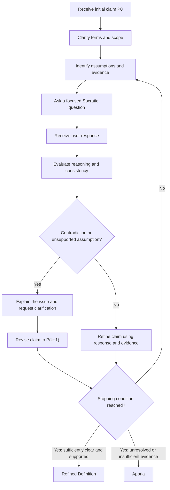

# Part 2 — AURA Socratic Protocol Map

## 1. Purpose

The AURA Socratic Protocol is a structured dialogue framework that helps users examine, clarify, and refine their claims through critical questioning.

Instead of immediately accepting or rejecting a proposition, the system identifies assumptions, examines supporting evidence, detects contradictions, and guides the user through iterative refinement.

The protocol has two possible terminal states:

- **Refined Definition:** The claim has become sufficiently clear, logically coherent, and supported by evidence for its intended scope.
- **Aporia:** The dialogue reaches an unresolved impasse because the available evidence, assumptions, or reasoning do not support a defensible conclusion.

Aporia is a legitimate outcome. The system must not invent certainty simply to reach a conclusion.

## 2. Socratic State Machine

The following state machine describes the dialogue process, from the initial claim to a refined definition or an unresolved conclusion.



The diagram represents a conceptual protocol. The implementation must follow its transition rules and record the reason for termination.

## 3. State Definitions

| State | Name | Purpose | Exit Condition |
|---|---|---|---|
| S0 | Claim Intake | Record the user's initial proposition, P0. | An initial claim is available. |
| S1 | Clarification | Identify ambiguous terms and establish the scope of the claim. | Important ambiguities have been identified. |
| S2 | Assumption Analysis | Identify explicit and implicit assumptions. | Relevant assumptions have been recorded. |
| S3 | Socratic Probe | Ask a focused question that examines the claim. | The user or dialogue participant provides a response. |
| S4 | Consistency Check | Examine the response for contradictions, unsupported assumptions, and evidential gaps. | The response has been evaluated. |
| S5 | Claim Refinement | Produce a revised proposition, P(k+1), using the discussion. | The revised proposition is recorded. |
| S6 | Completion Check | Determine whether further questioning is useful and whether the claim meets the stopping criteria. | A terminal state is selected or questioning continues. |
| T1 | Refined Definition | Present the refined claim and explain its scope and limitations. | Terminal state reached. |
| T2 | Aporia | Document unresolved questions, contradictions, and missing evidence. | Terminal state reached. |

## 4. Core Variables

The protocol maintains the following variables throughout the dialogue:

| Variable | Description |
|---|---|
| `P0` | The user's original proposition. |
| `Pk` | The current version of the proposition at iteration `k`. |
| `Pk+1` | The revised proposition after a question, response, or evidential update. |
| `assumptions` | The explicit and implicit premises underlying the claim. |
| `evidence` | Information that supports or challenges the proposition. |
| `contradictions` | Conflicts between statements, premises, or available evidence. |
| `uncertainties` | Issues that cannot currently be resolved. |
| `iteration_count` | The number of completed refinement cycles. |
| `max_iterations` | The maximum number of refinement cycles permitted. |
| `terminal_state` | Either `REFINED_DEFINITION` or `APORIA`. |

The original claim, P0, should be preserved for comparison with the final result. The system should not silently replace the user's original position.

## 5. Protocol Algorithm

The following pseudocode defines the main logic of the AURA Socratic Protocol.

```text
FUNCTION AURA_Socratic_Protocol(P0, max_iterations):

    Pk = P0
    iteration_count = 0

    assumptions = identify_assumptions(Pk)
    evidence = identify_available_evidence(Pk)
    uncertainties = identify_uncertainties(Pk)

    WHILE iteration_count < max_iterations:

        terms = clarify_ambiguous_terms(Pk)

        question = formulate_focused_question(
            claim = Pk,
            assumptions = assumptions,
            evidence = evidence,
            uncertainties = uncertainties
        )

        response = obtain_response(question)

        consistency = evaluate_consistency(
            claim = Pk,
            response = response,
            evidence = evidence
        )

        IF consistency reveals a contradiction:

            explain_contradiction()
            request_clarification()
            record_unresolved_issue()

            Pnext = revise_claim_using_response(Pk, response)

        ELSE:

            Pnext = refine_claim_using_response(Pk, response)

        END IF

        update_assumptions_evidence_and_uncertainties(Pnext)

        iteration_count = iteration_count + 1

        IF claim_is_clear(Pnext)
           AND reasoning_is_coherent(Pnext)
           AND evidence_is_adequate_for_scope(Pnext)
           AND material_uncertainties_are_disclosed(Pnext):

            RETURN REFINED_DEFINITION(
                claim = Pnext,
                assumptions = assumptions,
                evidence = evidence,
                uncertainties = uncertainties
            )

        END IF

        Pk = Pnext

    END WHILE

    RETURN APORIA(
        current_claim = Pk,
        unresolved_questions = uncertainties,
        evidence_gaps = identify_evidence_gaps(Pk)
    )

END FUNCTION
```

This pseudocode specifies the intended behavior; it does not, by itself, establish that every operation is implemented in the Python engine.

## 6. Contradiction Detection and Repair

A contradiction should trigger further examination rather than immediate rejection of the claim.

The protocol follows five steps.

### Step 1: Locate the Conflict

Identify the exact statements, assumptions, or pieces of evidence that appear incompatible.

### Step 2: Explain the Conflict

Explain why the statements appear inconsistent. The explanation should focus on the reasoning rather than attacking the person making the claim.

### Step 3: Ask for Clarification

Determine whether the conflict arises from different definitions, missing context, incompatible assumptions, or genuinely inconsistent propositions.

### Step 4: Refine the Claim

Revise the proposition only when the discussion provides a reason to do so. Preserve the user's intended meaning wherever possible.

### Step 5: Record the Outcome

Record whether the contradiction was resolved, partially resolved, or left open.

The protocol must distinguish between:

- A genuine logical contradiction.
- Ambiguous or imprecise language.
- Different meanings of the same term.
- A change in circumstances.
- Missing or unreliable evidence.
- Disagreement about ethical values rather than factual claims.

An AI system must not classify every disagreement as a contradiction simply because it disagrees with the user.

## 7. Claim Refinement: From P0 to P(k+1)

Claim refinement is an iterative process.

At each iteration, the system compares the current proposition with the information obtained during the dialogue.

A revision should ideally improve one or more of the following:

1. **Precision:** Important terms and boundaries are defined.
2. **Consistency:** Conflicting premises are resolved or explicitly acknowledged.
3. **Evidence:** Factual claims are better supported.
4. **Scope:** The proposition avoids unsupported universal claims.
5. **Transparency:** Remaining assumptions and uncertainties are disclosed.

A revised proposition does not necessarily have to become narrower. New evidence may justify strengthening a claim, while counterexamples may require limiting it.

The system should maintain a record of the original claim, relevant questions, responses, revisions, and reasons for each revision.

## 8. Stopping Criteria

The protocol must terminate when a justified stopping condition is reached.

### 8.1 Terminal State T1: Refined Definition

The system may return a Refined Definition when:

- The key terms and scope are sufficiently clear.
- The claim is internally coherent.
- Available evidence supports the claim to the degree asserted.
- Important counterarguments have been considered.
- Material uncertainties are disclosed.
- Further questioning is unlikely to produce a meaningful improvement.

The output should contain:

1. The refined proposition.
2. A short explanation of the changes from P0.
3. The main supporting reasons or evidence.
4. Important assumptions.
5. Remaining limitations.

A Refined Definition does not mean that a claim has been proven universally true. It means that the claim is sufficiently defensible within the stated scope.

### 8.2 Terminal State T2: Aporia

The system should return Aporia when:

- Essential evidence is unavailable.
- Important assumptions remain disputed.
- Contradictions cannot be resolved with the available information.
- Repeated questioning produces no meaningful progress.
- The maximum iteration limit is reached.
- The conclusion depends on unresolved ethical or philosophical values.

The Aporia output should contain:

1. The current proposition.
2. What the dialogue has established.
3. The unresolved questions or contradictions.
4. Missing evidence or information.
5. What would help the discussion progress.

Aporia is not equivalent to failure. It is an explicit acknowledgment that the available reasoning does not justify a definitive conclusion.

## 9. Illustrative Example: Open-Sourcing Advanced AI

The following example illustrates the protocol. It is not a report of an independently conducted experiment.

### Initial Claim P0

> Open-sourcing every advanced AI model is always beneficial.

### Clarification

The system asks what the speaker means by *open-sourcing* and *beneficial*.

Possible interpretations include:

- Publishing research and documentation.
- Providing access to model weights.
- Releasing training code and datasets.
- Allowing independent audits.
- Making a model available for unrestricted use.

The term *beneficial* could refer to scientific progress, public accountability, economic competition, or safety.

### Socratic Probe

> Would your claim remain true if releasing a model's weights substantially increased the ability of malicious actors to misuse it?

### Consistency Check

The word *always* makes the original claim vulnerable to counterexamples.

Furthermore, transparency and unrestricted release are not necessarily equivalent. A model can be independently audited without every component being publicly released.

### Refined Claim P1

> Greater transparency and independent scrutiny of advanced AI systems are generally beneficial, but unrestricted release of model weights should depend on evidence about the system's capabilities, foreseeable misuse, and available safeguards.

### Possible Terminal State

**Refined Definition**, provided that the discussion has sufficiently clarified the scope and acknowledged the remaining empirical uncertainty.

If the available evidence cannot establish the likely effects of release in a particular case, the protocol should preserve that uncertainty rather than claim to have resolved it.

## 10. Safeguards and Limitations

The protocol should follow these safeguards:

- Ask focused questions rather than overwhelming the user with multiple unrelated questions.
- Represent the user's position fairly before challenging it.
- Distinguish empirical claims from ethical judgments.
- Do not treat confidence, fluency, or repetition as proof.
- Do not invent evidence or citations.
- Do not silently change the user's position.
- Disclose uncertainty and limitations.
- Apply explicit stopping criteria to avoid endless questioning.
- Avoid manipulating the user toward a predetermined conclusion.
- Allow the user to disagree with the AI's interpretation.
- Preserve unresolved disagreements in the final report.

A language model may generate plausible-sounding arguments that are incorrect. The protocol therefore needs external evidence, human review, or domain-specific validation when the stakes require them.

## 11. Evaluation Framework

The protocol can be evaluated using the following criteria.

| Criterion | Evaluation Question | Possible Evidence |
|---|---|---|
| Clarity | Did the revised claim define important terms? | Comparison of P0 and the final claim. |
| Logical consistency | Were contradictions identified accurately? | Recorded contradictions and their resolution. |
| Evidence quality | Were factual claims supported appropriately? | Verified sources and documented evidence gaps. |
| Fairness | Was the user's position represented accurately? | Comparison between the user's statements and the system's summary. |
| Epistemic humility | Were uncertainty and limitations disclosed? | Explicit uncertainty statements in the final output. |
| Progress | Did each question contribute to refinement? | Changes between successive claim versions. |
| Termination quality | Was the terminal state justified? | Recorded stopping reason and unresolved issues. |
| Non-sycophancy | Did the system challenge weak reasoning when warranted? | Tests containing plausible but unsupported claims. |
| Robustness | Did the protocol handle ambiguity and contradictory responses? | Results from a predefined test set. |

These criteria define an evaluation framework. Actual performance scores must be based on recorded tests rather than assumed results.

## 12. Conclusion

The AURA Socratic Protocol treats dialogue as an iterative process of clarification, examination, and refinement.

Its success is not measured by whether the AI persuades the user or produces a confident-sounding answer. Instead, it is measured by whether the dialogue improves the precision and defensibility of a claim while preserving intellectual honesty.

The protocol therefore recognizes two legitimate outcomes: a Refined Definition when sufficient progress has been made, and Aporia when important questions remain unresolved.
